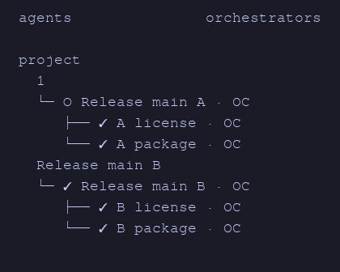

# OpenCode Herdr Autopanes

**Watch your OpenCode subagents without splitting your terminal.**

See agents grouped under their parent, click into their conversations, and
return to your main session. Each child is a full-size background tab in the
same Herdr workspace; launching it does not resize or steal focus from the
orchestrator.

**Useful links:** [install](#install) · [first workflow](#first-workflow) ·
[everyday controls](#everyday-controls) · [workspace guide](docs/workspaces.md) ·
[verification](VERIFICATION.md) · [security](SECURITY.md)



This is a real terminal-cell capture from an isolated package test, cropped and
rasterized for readability. The names are harmless demonstration sessions.

## Why use it

- **Keep the main view full-size:** children open as unfocused background tabs.
- **Find work quickly:** readable child names and status appear below each parent.
- **Inspect without losing context:** click a child conversation, then click its
  parent to return.
- **Keep results:** completed viewers remain available until you close them.

## Status

The published release is experimental **v0.2.1**. It includes
`/herdr-autopanes-close-completed`, accurate close results, workspace guidance,
and the documentation/media in this repository.

Grouping uses the bundled Herdr Sidebar companion extension, not stock
`hs_parent`: stock grouping is same-tab only. The bundled companion is pinned
to Herdr Sidebar 0.3.0,
[`8a45adc5c0dd02f5cffeae5e900738035c9b3b82`](companion/UPSTREAM.md), with the
cross-tab extension and upstream licenses/notices included.

## Requirements

Tested environment:

- Ubuntu 26.04.1 LTS
- OpenCode 2.3.2
- Herdr 0.9.5
- Node 26.13.1 / npm 12.2.3
- Python 3.14.4; setup requires Python 3.11+

The release setup currently supports Linux. It also needs `curl`, `sha256sum`,
and working `opencode` and `herdr` commands. Text labels work in VS Code
terminals without installing a font.

## Install

Run these commands in a shell **inside the Herdr session you want to use**.
Do not run setup from an OpenCode prompt.

```sh
mkdir -p "$HOME/.local/share/opencode-herdr-autopanes/0.2.1"
cd "$HOME/.local/share/opencode-herdr-autopanes/0.2.1"
BASE=https://github.com/rohithga1/opencode-herdr-autopanes/releases/download/v0.2.1
curl -fLO "$BASE/opencode-herdr-autopanes-0.2.1.tgz"
curl -fLO "$BASE/SHA256SUMS"
sha256sum -c SHA256SUMS
npm install --prefix "$PWD" --ignore-scripts --save-exact ./opencode-herdr-autopanes-0.2.1.tgz
NEW="$PWD/node_modules/opencode-herdr-autopanes"
python3 "$NEW/scripts/setup.py" install --dry-run
python3 "$NEW/scripts/setup.py" install
python3 "$NEW/scripts/setup.py" doctor
```

This installs dependencies locally and registers both components. It does not
publish to npm. OpenCode and Herdr reload their settings without a service
restart. Keep the versioned directory while it is registered.

For a v0.1.0 or v0.2.0 upgrade, keep the old package and pass its exact
absolute path:

```sh
OLD="/absolute/path/to/old/node_modules/opencode-herdr-autopanes"
python3 "$NEW/scripts/setup.py" install --upgrade-from "$OLD" --dry-run
python3 "$NEW/scripts/setup.py" install --upgrade-from "$OLD"
```

Existing customized sidebar installations are refused, not overwritten.
Compatible installed companions are reused without taking ownership. See
[companion attribution and update behavior](companion/UPSTREAM.md).

## First workflow

Ask your main agent:

> Launch two native subagents concurrently: “Read license” summarizes
> `LICENSE`; “Read package” summarizes `package.json`. Do not change files.
> Return both results normally.

The two rows appear below the main agent. Click **Read license** or **Read
package** to open its full-size conversation. Click the main agent row to
return. A second orchestrator in the same workspace gets its own group.

## Everyday controls

### Inspect and return

Click a child row in Herdr’s left sidebar to inspect it. Click its parent row
to return to the orchestrator. Grouping is visual and not collapsible.

### Close completed viewers

In this checkout, the new palette/slash command is:

```text
/herdr-autopanes-close-completed
```

It reports exactly how many tabs closed, how many were skipped and why, and how
many closures failed. It closes only this owner’s finished, unpinned,
uninspected viewers. Running work, active descendants/background shells,
pending forms/permissions, ownership-uncertain viewers, and the viewer
currently focused in Herdr remain open. Conversations are preserved; native
sessions are never cancelled.

Inspection protection is transient: viewing a completed child and then
returning to its parent does **not** permanently exclude that child from this
explicit action. Explicit pins are separate from automatic focus protection and
remain protected. Automatic closing stays conservative and disabled by default.

The command is included in v0.2.1.

### Cleanup everything owned here

```text
/herdr-autopanes-cleanup
```

Cleanup is broader: it closes all plugin-owned viewer tabs for the current
parent group, including running viewers. It does not cancel their native work.
Its notification is: **“Viewer tabs closed. Conversations preserved; any active
work continues.”**

### Other controls

```text
/herdr-autopanes-status
/herdr-autopanes-retry CHILD_SESSION_ID
```

When the viewer limit is reached, retained viewers count. The warning suggests
`/herdr-autopanes-close-completed`, followed by retrying
the skipped child. Native work continues even when no viewer is opened.

## Defaults and configuration

The normal defaults are:

```json
{
  "mode": "tabs",
  "maxPanes": 4,
  "closeOnCompletion": false,
  "closeDelaySeconds": 60
}
```

`mode: "split"` remains available. Automatic closing is off by default.
When enabled, the currently focused viewer is protected and focus-stream
failure disables automatic closing. Viewing a child and returning to the parent
does not permanently pin it. Explicitly pinned viewers remain protected.
No close operation is race-free across Herdr and OpenCode; a last-moment click
or resumed work can race an already-dispatched close.

## Workspace basics

See the short [workspace guide](docs/workspaces.md) for spaces, tabs,
reconnection, project directories, and safe workspace creation.

## Troubleshooting and limitations

- Run `python3 "$NEW/scripts/setup.py" doctor` inside the intended Herdr shell.
- `herdr` reconnects to the existing default session; it does not create a new
  session on every invocation.
- A Herdr workspace is a space for related projects; tabs are terminals inside
  that space. Changing directories does not switch spaces.
- Use one sidebar reporter. Competing `agent.view.set` reporters can conflict.
- Ownership metadata is same-user bookkeeping, not a hostile-process boundary.
- Native nested delegation, cold recovery of retained viewers, and remote HTTPS
  Basic authentication remain unverified.
- The dependency graph retains two moderate advisories. See
  [DEPENDENCIES.md](DEPENDENCIES.md); no forced upgrades were used.

Advanced architecture and release evidence live in
[docs/grouped-viewers.md](docs/grouped-viewers.md),
[SECURITY_REVIEW.md](SECURITY_REVIEW.md), and
[v0.2.1 release receipt](https://github.com/rohithga1/opencode-herdr-autopanes/blob/v0.2.1/release-checks/0.2.1.md).

## Uninstall

```sh
python3 "$NEW/scripts/setup.py" uninstall --dry-run
python3 "$NEW/scripts/setup.py" uninstall
```

Only owned registrations and sidebar changes are removed. Later unrelated
settings are preserved; customized managed tables cause a refusal rather than
an overwrite. The package, preferences, backups, and reused user-owned
companion remain available.

## Contributing, license and credits

Contributions and issues: [GitHub repository](https://github.com/rohithga1/opencode-herdr-autopanes).
Please preserve the pinned companion’s [copyright and notices](companion/LICENSE).
Autopanes is MIT-licensed; the bundled companion retains its own MIT license and
third-party artwork attribution. This is an independent, non-official Herdr
extension.
